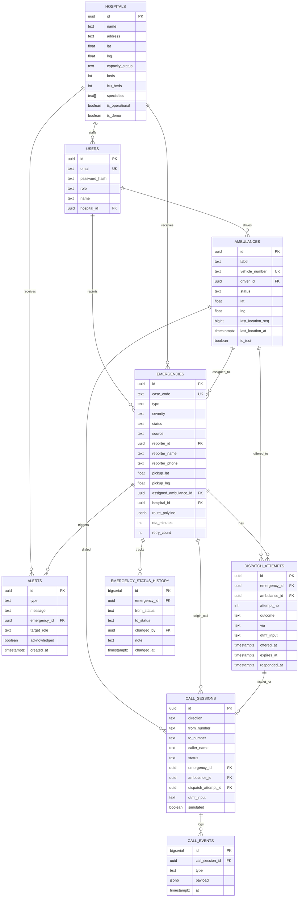

# AidFlow Data Model & Database Architecture

AidFlow uses a relational schema in PostgreSQL managed by sequential migrations (`001_init.sql`, `002_calls_and_dispatch.sql`).

---

## 1. Entity-Relationship Diagram



---

## 2. Concurrency Safety Nets & Partial Unique Indexes

1. **One Active Case Per Ambulance**:
   ```sql
   CREATE UNIQUE INDEX one_active_case_per_ambulance
     ON emergencies (assigned_ambulance_id)
     WHERE assigned_ambulance_id IS NOT NULL
       AND status IN ('assigned','en_route','reached_patient','heading_to_hospital');
   ```
2. **One Pending Attempt Per Case**:
   ```sql
   CREATE UNIQUE INDEX one_pending_attempt_per_case
     ON dispatch_attempts (emergency_id)
     WHERE outcome = 'pending';
   ```
3. **One Accepted Attempt Per Case**:
   ```sql
   CREATE UNIQUE INDEX one_accepted_attempt_per_case
     ON dispatch_attempts (emergency_id)
     WHERE outcome = 'accepted';
   ```
4. **One Outbound IVR Call Per Attempt**:
   ```sql
   CREATE UNIQUE INDEX one_call_per_dispatch_attempt
     ON call_sessions (dispatch_attempt_id)
     WHERE dispatch_attempt_id IS NOT NULL;
   ```
