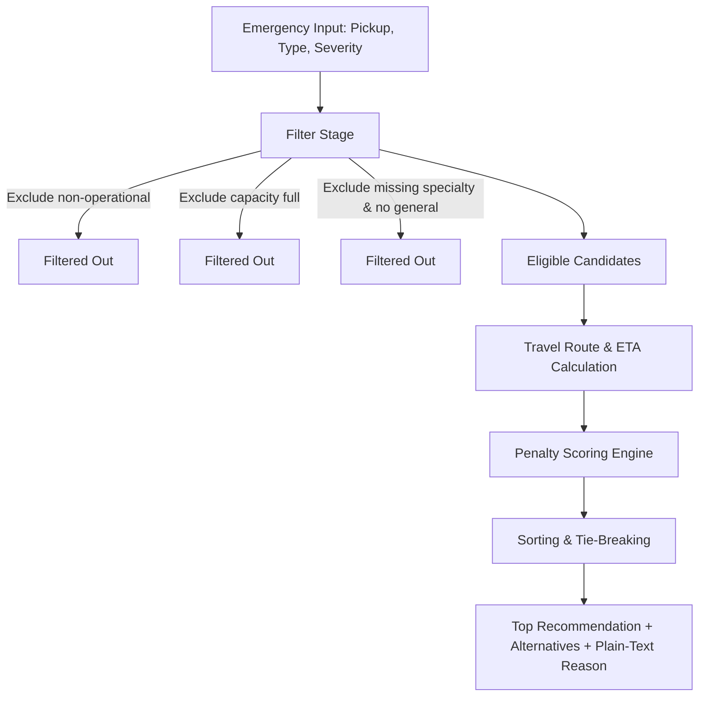

# AidFlow Routing & Hospital Recommendation Specification

## 1. Overview

AidFlow implements a modular routing and recommendation system designed to support both offline/demo operations and production deployments. The system is split into two distinct engines:
1. **Routing & ETA Engine**: Computes path geometry, road distance, and travel time estimates between spatial coordinates.
2. **Hospital Recommendation Engine**: Evaluates available medical centers against emergency triage requirements, bed capacity, ICU availability, telemetry freshness, and transit time to recommend the best facility.

---

## 2. Routing Providers (`RoutingProvider`)

The system selects a routing provider via the `ROUTING_PROVIDER` environment variable (`haversine`, `graph`, `osrm`, or `ors`). All providers conform to the following interface:

```typescript
export interface RoutingProvider {
  name: 'haversine' | 'graph' | 'osrm' | 'ors'
  route(from: LatLng, to: LatLng): Promise<RouteResult>
}

export interface RouteResult {
  distanceKm: number
  durationMin: number
  geometry: LatLng[]
  source: 'haversine' | 'graph' | 'osrm' | 'ors'
  assumptions: string
}
```

### 2.1 Provider Implementations

| Provider | Mechanism | Speed / Road Factor | Behavior & Fallback |
|---|---|---|---|
| `haversine` *(default)* | Spherical Great-Circle calculation | $R = 6371\text{ km}$, road factor $1.3\times$, assumed speed $35\text{ km/h}$ | Zero external dependencies; instant calculation; straight-line geometry `[from, to]`. |
| `graph` | Custom Bangalore road graph with Dijkstra & A* | Bidirectional edge weights, snapping to nearest node, assumed speed $35\text{ km/h}$ | Full waypoint polyline along graph nodes; guaranteed optimal path. |
| `osrm` | Open Source Routing Machine HTTP API | Road network speed profiles from OSM data | 3-second timeout; automatically falls back to `haversine` on network/server error or unconfigured URL. |
| `ors` | OpenRouteService Driving Car GeoJSON API | Real-world road graph speed profiles | 3-second timeout; requires `ORS_API_KEY`; automatically falls back to `haversine`. |

### 2.2 Transparency and Traffic Claims (Ground Rule 3)

> [!IMPORTANT]
> **No Live-Traffic Claim**: AidFlow does not claim live congestion or real-time traffic speeds in this academic build. Every route response and database record includes `etaSource` and an `assumptions` explanation string.

---

## 3. Graph Shortest Path: Dijkstra vs. A* Comparison

The graph routing module provides both **Dijkstra's Algorithm** and **A\* Search** with an admissible **Haversine Distance Heuristic** over the demo road network.

Benchmark script: `npm run routing:compare`

### Benchmark Results

| Origin -> Destination | Dijkstra Dist (km) | Dijkstra Nodes Expanded | A* Dist (km) | A* Nodes Expanded | Result |
|---|---|---|---|---|---|
| N1 (MG Road) -> N5 (Hebbal) | 9.55 | 9 | 9.55 | 4 | **Identical / 55% fewer nodes** |
| N6 (JP Nagar) -> N2 (Indiranagar) | 15.38 | 8 | 15.38 | 8 | **Identical** |
| N4 (Jayanagar) -> N10 (Mekhri Circle) | 13.14 | 9 | 13.14 | 5 | **Identical / 44% fewer nodes** |
| N3 (Koramangala) -> N5 (Hebbal) | 17.83 | 10 | 17.83 | 8 | **Identical / 20% fewer nodes** |
| N6 (JP Nagar) -> N10 (Mekhri Circle) | 15.58 | 9 | 15.58 | 6 | **Identical / 33% fewer nodes** |

### Why Custom Graphs are Limited to Demo Areas

1. **Graph Maintenance Overhead**: Manually maintaining nodes, turn restrictions, one-way streets, overpasses, and speed limits across a metropolitan area requires millions of edges and continuous map updates.
2. **Snapping Inaccuracies**: In sparse graphs, coordinate snapping to distant junctions introduces displacement error.
3. **Production Recommendation**: For production systems, OSRM (self-hosted container) or OpenRouteService provides global OpenStreetMap ingestion, turn-by-turn guidance, and contraction hierarchies.

---

## 4. Hospital Recommendation Engine

Implemented in `modules/routing/recommend.ts` and exposed via `GET /hospitals/recommend`.

### 4.1 Specialty Mapping Matrix

| Emergency Type | Primary Specialties Required | Acceptable Fallback |
|---|---|---|
| `cardiac` | `cardiology` | `general` |
| `stroke` | `neurology` | `general` |
| `burn` | `burns` | `general` |
| `trauma`, `accident`, `fracture` | `trauma`, `orthopaedics` | `general` |
| `breathing` | `pulmonology` | `general` |
| `poisoning` | `toxicology`, `emergency` | `general` |
| `other` | `general` | `general` |

### 4.2 Three-Stage Pipeline



### 4.3 Penalty Scoring Formula

$$\text{Score} = \text{ETA (minutes)} + \sum \text{Penalties}$$

Lower score wins.

| Factor | Penalty | Rationale |
|---|---|---|
| `capacity_status == 'limited'` | **+5** | High utilization; possible diversion delay upon arrival |
| `capacity_status == 'unknown'` | **+8** | Unverified capacity; higher triage risk |
| Telemetry Stale ($>24\text{h}$) | **+5** | Telemetry may not reflect current bed availability |
| Critical case with 0 ICU beds | **+10** | Critical cases require immediate intensive care capabilities |
| General fallback without specialty match | **+6** | Secondary transfer may be required for specialized intervention |

**Tie-Breaking Order**:
1. Lower total score
2. Shorter road distance (km)
3. Alphabetical hospital name
